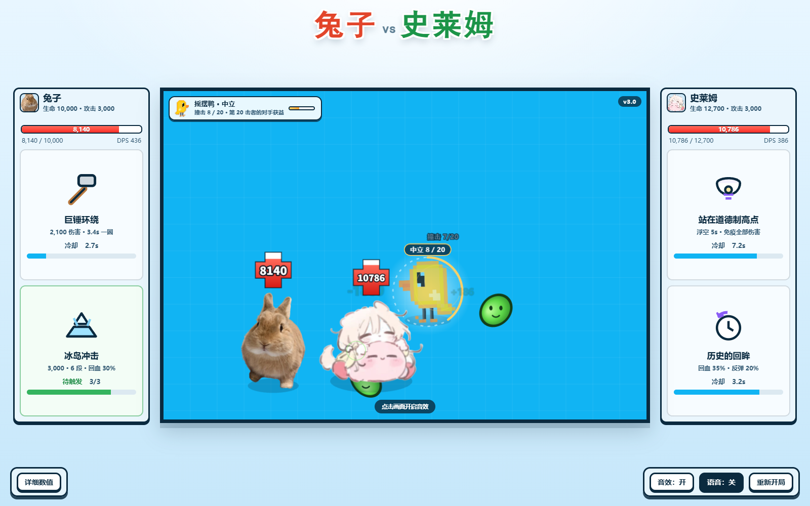
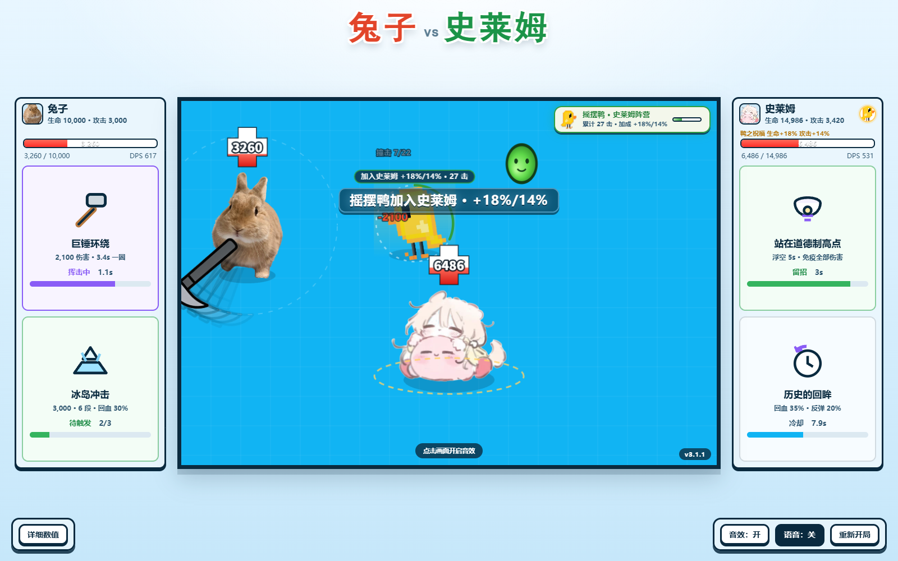
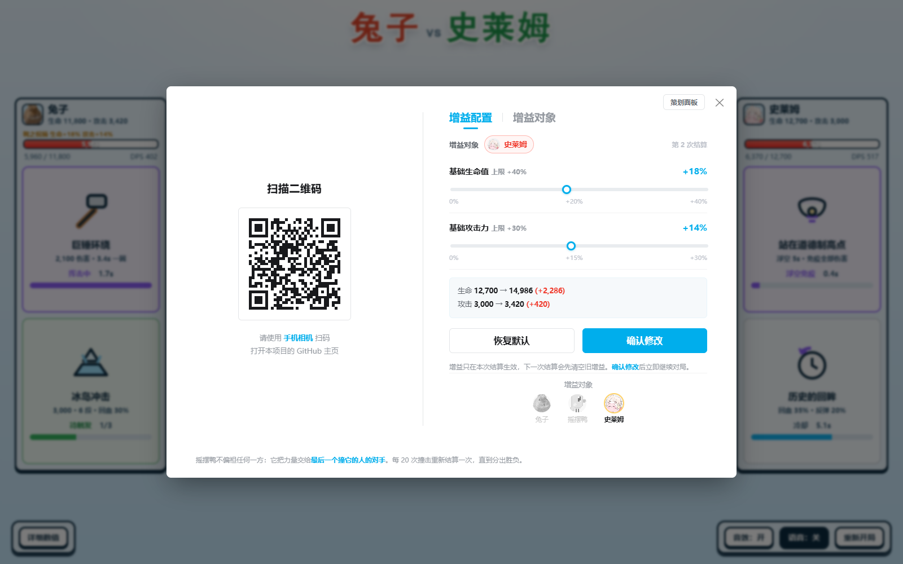
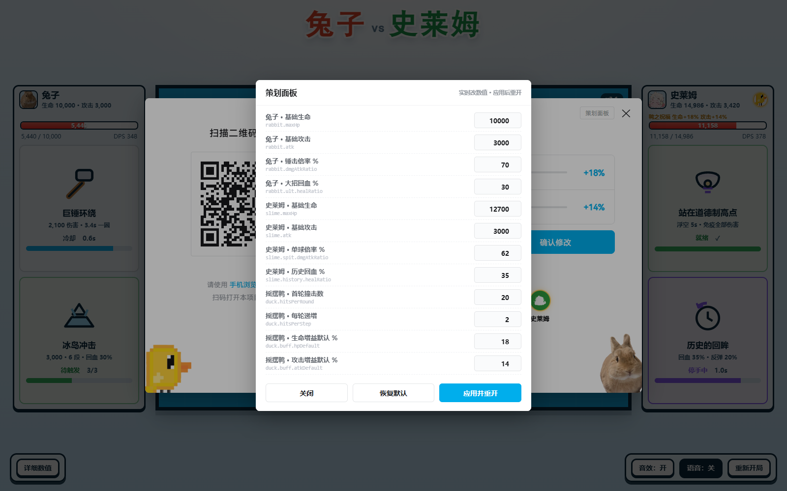

# 兔子 vs 史莱姆 vs 摇摆鸭 · 实时演算对战

一个**单文件、可实时演算**的 2D 擂台对战 Demo：白兔扛着巨锤绕身旋转，史莱姆靠喷吐小球和两个「哲学技能」周旋，
而场中央还站着一只**摇摆鸭**——它谁的人都不是，但每一次撞击都在改变天平。

所有战斗都是每帧实时计算的，不是视频，也不是播片。



打开 `bounce-duel/duel-live.html` 就能看，无需服务器、无需联网（图片全部 base64 内联）。

```
兔子    10000 生命 / 3000 攻击     巨锤环绕 · 冰岛冲击（3 次）
史莱姆  12700 生命 / 3000 攻击     站在道德制高点 · 历史的回眸
摇摆鸭  中立                        每 20 次撞击 → 撞击者的对手获得增益
```

---

## 快速开始

| 做法 | 说明 |
|---|---|
| 只想看 | 双击 `bounce-duel/duel-live.html`（Chrome / Edge） |
| 想看音效 | **首次需要点一下画面**（浏览器要求手势才允许出声） |
| 想调数值 | 见下方[「怎么改」](#怎么改数值)，或直接用弹窗里的**策划面板** |
| 想测平衡 | `python bounce-duel/_tune.py 100 --rand` |
| 手机上玩 | 竖屏也行：≤780px 时增益弹窗会自动换成纵向排版 |

右下角三个开关：**音效（默认开）/ 语音播报（默认关）/ 重新开局**；左下角是**详细数值**（实时面板，展开后技能卡会自动收缩让位）。

> 对局进行到大约 12 秒时，摇摆鸭会弹出一次增益结算窗口——**这是设计的一部分**，调完滑块点「确认修改」就继续打。

---

## 对战机制

### 兔子

| 技能 | 效果 |
|---|---|
| **巨锤环绕** | 每 3.4 秒抡一次，锤心绕身旋转、锤头朝外；命中 2100（21% 对方生命）。距离超过 250 会先冲刺贴身 |
| **冰岛冲击** | 生命掉到 20% 自动触发，**全局 3 次**。锁血 2 秒 → 冰冻双方 3 秒 → 背景换成极光雪原 3.4 秒；期间分 **6 段 × 500** 结算伤害（总 3000），并回复「此前累计造成伤害的 30%」。**范围技，会顺带扫到摇摆鸭**（一次大招计 1 击） |

### 史莱姆

| 技能 | 效果 |
|---|---|
| **喷吐** | 每 3 秒喷一组小球，单球 1860（18.6% 生命）；场上已有球时，第二发会转向去撞它 → **分裂成 2 颗小球**。命中吸血 = `ceil(实际伤害 × 10%)` |
| **站在道德制高点** | CD 30 秒，浮空 5 秒，期间**免疫全部伤害**。会被动「留招」等兔子放大招时对轴（45% 概率完全挡掉） |
| **历史的回眸** | CD 15 秒，回复「上一个 10 秒窗口承伤」的 35%，并把「最近 10 秒承伤」的 20% 反弹给兔子；代价是**停手 5 秒** |

### 摇摆鸭（v3.0 新增）



| 项 | 效果 |
|---|---|
| 阵营 | **中立**。既不属于左边也不属于右边，一开场就在场 |
| 形态 | **半透明**，能看见底下的场地；被撞会飞、被打会有反馈，但**不掉血、不会死** |
| 走位 | 自动追向两名角色的中点，并左右摇摆——它永远往交火线上钻 |
| 计数 | 每挨一次撞击 **累计 +1**（同一角色 0.34 秒内只算一次），头顶与状态条都显示累计数，外圈是**本轮**进度环 |
| 结算 | 第 1 轮满 **20** 次、第 2 轮 **22** 次、第 3 轮 **24** 次…（每轮 +2）；结算那一击的**撞击者的「对手」**获得增益，同时清空上一次增益 |
| 默认增益 | **+18% 基础生命 / +14% 基础攻击**（可调，见下） |
| 头像 | **中立时贴在场地正中**；加入阵营后**整块滑到那一侧**并换成该阵营的主题色（红/绿），同时那一侧卡片右上角出现鸭子头像 |

**为什么是「撞击者的对手」？** 因为这样才有博弈：谁打鸭子，谁就是在给对面送增益。
但鸭子会自己往交火线钻，绕不开——于是「打不打得到」变成了走位和技能节奏的一部分。

#### 增益结算弹窗（1:1 复刻 B 站登录框）

整张卡固定 **1010 × 600**，屏幕不够就整卡等比缩放——所以任何分辨率下版式完全一致。
每个元素的位置都是量出来的（左标题 y=70、二维码 (93,109) 213×213、竖线 x=399、
标签页 (458,55)、输入框 (458,115) 497×142、按钮高 48、图标 y=392、条款 y=516…）。



| 原版 | 本作 |
|---|---|
| 左侧扫码登录二维码 | 指向本仓库 <https://github.com/Yang1yangcz/bunny-vs-slime> 的二维码 |
| 「账号」输入框 | **基础生命**滑块（0 ~ +40%） |
| 「密码」输入框 | **基础攻击**滑块（0 ~ +30%） |
| 密码行右侧「忘记密码?」 | 实时百分比 **+18%** |
| 「注册」 | **恢复默认** |
| 「登录」 | **确认修改** |
| 底部「其他方式登录」三个图标 | 兔子 / 摇摆鸭 / 史莱姆，纯色圆 + 白色剪影，当前增益方高亮 |
| 底部「未注册过哔哩哔哩的手机号…」 | 摇摆鸭的结算规则说明 |
| 左上 / 右下角吉祥物 | 摇摆鸭 / **当前增益对象**（兔子或史莱姆，跟着结算结果换） |
| 右上角关闭 | 旁边多一个 **策划面板** 按钮 |

滑块拖动即时生效，点「确认修改」或直接关掉窗口都算数。

#### 策划面板



弹窗右上角「策划面板」调出，11 项数值随便改，点「应用并重开」立刻生效：

兔子 生命 / 攻击 / 锤击倍率 / 大招回血；史莱姆 生命 / 攻击 / 单球倍率 / 历史回血；
摇摆鸭 结算撞击数 / 生命增益默认值 / 攻击增益默认值。

### 伤害模型

全场**只有 `atk` 是绝对数值**，其余全部是百分比：

```
实际伤害 = 基础攻击 × 系数
```

因为 3000 攻击 / 10000 生命，所以 **系数 × 0.30 就等于「对方基础生命的百分之几」**，调参时可以直接按「几发打死」来想。

摇摆鸭的增益是**乘在基础值上**的：`生命 × (1 + 0.18)`、`攻击 × (1 + 0.14)`，
并且会把多出来的那部分生命**直接补给当前血量**（相当于一次护盾式回血），换人时再收回去。

---

## 怎么改数值

### 最快的办法（不用重新构建）

1. 用编辑器打开 `bounce-duel/duel-live.html`
2. 搜索 `const CFG`（在 `<script>` 开头第 ① 区，每项都有中文注释）
3. 改完保存，刷新浏览器即可

> 注意：直接改 `duel-live.html` 的改动，会在下次运行 `_build_live.py` 时被覆盖。

### 常改的参数

| 参数 | 当前值 | 含义 |
|---|---|---|
| `arena.w / h` | 1080 / 740 | 战场逻辑尺寸 |
| `rabbit.maxHp / atk` | 10000 / 3000 | 兔子基础生命 / 攻击 |
| `rabbit.dmgAtkRatio` | 0.70 | 锤击 = 0.70 × 攻击 = 2100 |
| `rabbit.hammer.period` | 3.4 | 几秒抡一圈 |
| `rabbit.ult.uses` | 3 | 冰岛冲击全局次数 |
| `rabbit.ult.hpThreshold` | 0.20 | 掉到多少血触发 |
| `rabbit.ult.dmgAtkRatio` | 1.00 | 大招总伤 = 3000（再按 `ticks` 拆分） |
| `rabbit.ult.ticks / tickGap` | 6 / 0.5 | 分几段、每段间隔 |
| `rabbit.ult.healRatio` | 0.30 | 瞬发回血 = 30% × 此前累计伤害 |
| `slime.maxHp / atk` | 12700 / 3000 | 史莱姆基础生命 / 攻击 |
| `slime.spit.period` | 3.0 | 几秒喷一组 |
| `slime.spit.dmgAtkRatio` | 0.62 | 单球 = 1860 |
| `slime.lifestealRatio` | 0.10 | 吸血比例（按实际伤害向上取整） |
| `slime.moral.cd / air` | 30 / 5 | 道德制高点 CD / 浮空时长 |
| `slime.moral.counterChance` | 0.45 | 对轴成功概率 |
| `slime.history.cd / mute` | 15 / 5 | 历史的回眸 CD / 停手时长 |
| `slime.history.healRatio` | 0.35 | 回血 = 上一窗口承伤 × 35% |
| `duck.size` | 140 | 摇摆鸭立绘长边（也是个「靶子大小」旋钮） |
| `duck.speed / chase` | 320 / 0.95 | 游走速度 / 追向双方中点的力度 |
| `duck.hitCooldown` | 0.34 | 同一角色连续撞击的计数间隔，**决定结算来得快不快** |
| `duck.hitsPerRound` | 20 | 第一轮需要的撞击数 |
| `duck.hitsPerStep` | 2 | 之后每结算一次，所需撞击数 +2（20 → 22 → 24…） |
| `duck.buff.hpMax / atkMax` | 0.40 / 0.30 | 两条滑块的上限 |
| `duck.buff.hpDefault / atkDefault` | 0.18 / 0.14 | 弹窗滑块的默认值（也就是「不调直接用」的增益） |
| `duck.buff.autoConfirm` | false | true = 不弹窗，直接按默认值结算（脚本批量跑用） |

### 改了模板怎么办

`duel-live.html` 是构建产物，真正的源码是 `live.template.html`（图片用占位符，构建时替换成 base64）：

```bash
cd bounce-duel
python _build_live.py     # 读 live.template.html + assets/ → 生成单文件 duel-live.html
```

改画面、改逻辑、加特效都要动 `live.template.html`，然后重新构建。

---

## 平衡怎么测

`_tune.py` 是自带的批量对局脚本，用无头 Chrome 跑实时演算并统计胜率：

```bash
python bounce-duel/_tune.py 100 --rand          # 100 局随机对局
python bounce-duel/_tune.py 100 --rand slime.spit.dmgAtkRatio=0.65   # 临时改参数再测
python bounce-duel/_tune.py 24                  # 固定种子（可复现，用于对比）
```

> 100 局约 8 秒（脚本用 `__sim.advance(秒, true)` 跳过渲染只跑逻辑）。

**当前平衡：200 局，兔子 96 : 史莱姆 104（48% : 52%），平均 31.9 秒。**

摇摆鸭部分（同一批 200 局）：

| 指标 | 数值 |
|---|---|
| 触发过增益的对局 | 199 / 200 |
| 首次结算时间（中位） | 12.0 秒 |
| 平均撞击次数 | 45.8 次 |
| **被增益方胜率** | **71%** |
| 被增益方获胜时剩余生命 | 28%（其中 47% 是 <25% 的险胜） |

设计目标是「被增益方大概率赢，但不能碾压」——71% 的胜率配上 28% 的残血，差不多就是这个手感。
把两条滑块调到 0 就退化成纯 1v1。

> 门槛递增后第 2 次结算要 42 次撞击，多数对局吃不到，所以比 v3.0 略温和；
> v3.0 记录的 84% 是偏高的单次抽样，同一套数值多跑几次落在 69%~84% 之间。

⚠️ 这套数值对「几发打死」非常敏感：单球伤害每跨过一个整数阈值，胜率会跳 20 个点。**8~24 局的样本完全不可信**（±10~25%），至少 100 局。

---

## 调试接口

打开页面后在控制台：

```js
__sim.state()            // 当前状态：血量、输出、大招次数、技能 CD、场上球数、鸭子状态
__sim.advance(10)        // 快进 10 秒
__sim.advance(10, true)  // 静默快进（不渲染，批量模拟用）
__sim.pause()            // 暂停实时主循环，改由 advance 手动推进
__sim.resume()           // 恢复

__sim.duckState()        // 鸭子：撞击数、阵营、增益值、双方当前生命/攻击
__sim.settle('rabbit')   // 手动结算一次增益（不等 20 次撞击）
__sim.setAuto(true)      // true = 不弹窗，直接按默认值结算

__CFG.slime.spit.period = 3.5   // 实时改参数（点「重新开局」后生效）
__CFG.duck.buff.hpDefault = 0.25
```

---

## 目录结构

```
docs/screenshots/         ← README 用的截图
bounce-duel/
├── duel-live.html        ← 交付物：单文件，双击即用（785 KB）
├── live.template.html    ← 源码模板（图片为占位符）
├── _build_live.py        ← 构建：模板 + assets → 单文件
├── _tune.py              ← 批量对局 / 平衡测试
├── _check_v3.py          ← 自检：抓 JS 报错 + 关键帧截图
├── _shots.py             ← 生成 docs/screenshots/ 里的截图
├── CHANGELOG.md          ← v2.0 → v3.0 的完整变更记录
├── assets/src/           ← a.png / b.png / hammer.png / iceland.jpg / qr.png
├── art/                  ← a.png / b.png / duck.png（摇摆鸭去白底版）
│
├── duel.html / duel.mp4  ← 旧版「视频管线」产物（bounce-duel-video 技能生成，非实时演算）
├── scene.json / scene.template.html / art/ / props/   ← 旧版视频管线的配置与素材
└── _test_live.py         ← 截图自检脚本
```

**两套东西要分清**：`duel-live.html` 是实时演算（现在的主线）；`duel.mp4` / `duel.html` 是早期用 `bounce-duel-video` 技能渲染的视频，机制和现在完全不同，仅作存档。

---

## 版本历史

完整记录见 [`bounce-duel/CHANGELOG.md`](bounce-duel/CHANGELOG.md)，git 里每一版都有 tag：

| tag | 内容 |
|---|---|
| v2.0 | 视觉重做：蓝底描边、十字血条、冰岛背景、对轴机制 |
| v2.1 | 技能 CD 调整 + 释放 AI（留招 / 保命 / 到点必放） |
| v2.2 | 大屏适配、场地加大、K.O. + MVP 结算 |
| v2.3 | 侧栏等高、全屏冰岛、语音播报、详情进侧栏 |
| v2.4 | 控制按钮收进左下 / 右下悬浮坞 + 音效开关 |
| v2.5 | 冰岛冲击 3 次 + 释放回血 + 伤害统一为「基础攻击 × 百分比」 |
| v2.6 | 侧栏填满、详情铺满、黑体标题 |
| v2.7 | 吸血改为按实际伤害 10% 向上取整 + 史莱姆血量上调 |
| v2.8 | 冰岛冲击改为持续伤害（6 段 × 500） |
| v2.9 | 冰岛冲击 7 秒冷却 + 结束后续回 5%（**已被 v2.10 回退**） |
| v2.10 | 回退到 v2.8 行为 |
| v2.11 | 历史的回眸回血 30% → 35% |
| v2.12 | 历史的回眸停手 10s → 5s，400 局重新配平 |
| v2.13 | 语音默认关闭、音效默认开启 |
| v3.0 | 摇摆鸭（中立单位）+ B 站风增益弹窗 + 策划面板，100 局重新配平 |
| v3.1 | 弹窗 1:1 复刻 B 站登录框、撞击计数改累计 + 每轮 +2 门槛、鸭子弹簧形变、头像跟随阵营 |
| v3.1.1 | 弹窗右下角立绘跟随增益对象切换 |
| v3.1.2 | 状态条滑向阵营并换主题色、弹窗进出场动效 + 音效、冰岛冲击可命中鸭子 |
| **v3.1.3** | **弹窗竖屏适配（≤780px 纵向排版）、修滑块挤掉数值、同步 index.html 到 bunny-vs-slime-html** |

```bash
git log --oneline --decorate     # 看历史
git diff v2.8 v2.9               # 对比任意两版
git checkout v2.13 -- bounce-duel/live.template.html   # 取回旧版文件
```

v2 的界面长这样（v3.0 之前）：


---

## 素材与许可

- 角色立绘：项目作者提供的 `兔子.png` / `史莱姆.png` / `锤子.png` / `摇摆鸭.png`
  （摇摆鸭原图是白底，用 `Pillow` 去掉近白像素、裁剪透明边后存为 `art/duck.png`）
- 二维码：`qrcode` 生成，内容为本仓库地址，已用 OpenCV `QRCodeDetector` 解码校验
- 冰岛背景：Unsplash 免费可商用图片（极光雪原），已压缩内联
- 技能图标：页面内手写 SVG（无外部依赖）
- 音效：运行时用 Web Audio API 合成，没有音频文件

## 已知限制

- 语音播报依赖系统中文语音包，没有的话不会出声（默认也是关闭的）
- 单文件 785 KB，因为所有图片都 base64 内联（好处是双击即用、可直接分享）
- 增益弹窗会**真的暂停实时主循环**，不理它就一直停在那儿（这是刻意的：它是一个决策点）
- 胜负由实时模拟决定，不可「导演」；想要固定剧情的分镜动画得另做一版脚本化动画
